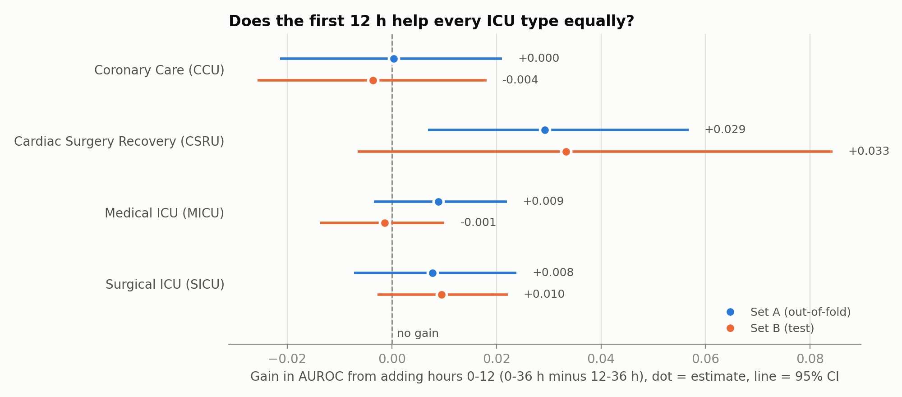

## Problem

ICU teams need to know early which patients are at highest risk of dying in hospital, while there is still time to act. The PhysioNet 2012 dataset holds up to 48 hours of monitoring for 8,000 ICU stays: 6 values recorded at admission and 37 measurements taken repeatedly, from heart rate to lab tests. The task was to predict in-hospital death at hour 36, training on 4,000 patients and testing on the other 4,000.

## What the data showed before any modeling

- **Two thirds of the data is empty.** Heart rate is missing in 1.5% of time slots, but most lab values in over 80%.
- **Whether a test was ordered is itself a signal.** Patients who had lactate measured died at 19.3%, against 10.9% for those who didn't. A doctor ordering a test says something about how worried they are.
- **Only about 14% of patients died**, so a model that always predicts "survives" looks 86% accurate while being useless.

## One score, five alert rules

A risk score only becomes useful once someone decides where to draw the line. I chose each threshold on the training data, then applied it unchanged to the test patients:

| Rule | Deaths caught | What it costs |
|---|---|---|
| Balanced (max F1) | 64.6% | 44% of flagged patients die; fewest false alarms |
| Favor catching deaths (max F2) | 86.8% | Specificity drops to 68% |
| Never miss (sensitivity ≥ 90%) | 91.7% | Flags 49% of all patients, about 3.8 flags per death caught |
| Fixed review budget (top 15%) | — | Highest precision: 47.7% of flagged patients die; suits a fixed number of staff or beds |

There is no single right threshold. It depends on who acts on the alert and how many alerts they can handle.

## My own question

The course asked for an original research question. I asked whether the first 12 ICU hours help every type of patient equally. My hypothesis was that they help cardiac surgery patients least, because their early readings mostly reflect anesthesia wearing off.

The data pointed the other way. Cardiac surgery patients gained the most (AUROC +0.029 in training, +0.033 on test), and coronary care patients gained nothing. Because the confidence intervals overlapped, I reported the hypothesis as **not supported**, rather than claiming the reverse was proven.

A follow-up look suggested why: cardiac surgery patients who were still unresponsive at hour 10 died at about 8%, against 2–4% for the rest. Slow recovery after surgery seems to carry real warning signal. I labeled this as exploratory, since I only looked after seeing the main result.

## Pipeline

- **Preprocessing (set by the course):** convert each patient's long table of readings into 2-hour bins, keep hours 12–36, exclude 8 patients per set with no data in the window, and pad the rest to 13 time steps.
- **Imputation:** I designed a two-level rule, fill from the patient's own mean first and from the training-set mean only when the patient was never measured, and treated an unrecorded ventilator flag as "not ventilated".
- **Model features:** for the model I flattened each patient into one row of 331 features: 9 summaries per variable (first, last, mean, min, max, standard deviation, count, slope and the mean of the last 12 hours) plus the admission values.

## Testing each choice instead of assuming it

Every decision was compared with 5-fold cross-validation on the training set, repeated over 3 seeds. The test set was used once, at the end.

| Question | Winner | AUROC / AUPRC |
|---|---|---|
| Hours 12–36 or 0–36? | 0–36 | 0.845 / 0.476 (vs 0.837 / 0.468) |
| Impute, or leave gaps for LightGBM? | Leave gaps | 0.845 / 0.476 (vs 0.839 / 0.457) |
| How to handle 14% deaths? | Barely matters; mild class weight | all ≈ 0.84 / 0.47 |
| Model settings | 1,500 trees, learning rate 0.01 | 0.847 / 0.482 |
| Logistic regression, same features | Benchmark only | 0.802 / 0.387 |

Two of these overturned my own earlier work. I had argued for starting at hour 12 and had built the imputation rule, yet the model did better with the early hours included and with the gaps left in. Leaving gaps lets the model use *whether* something was measured, which the data had already shown was informative.

## Result

On the 3,992 test patients the final model reached **AUROC 0.859 and AUPRC 0.535**, close to the cross-validation estimate, so there was no sign of overfitting to the training set. The saved model predicts from a raw patient file in about 56 ms. All seeds tried are logged, and the notebook runs end to end on Google Colab.

## Statistics for the open question

The ICU-type comparison used one model per time window with ICU type as an input, since separate models would have too few deaths (43 in cardiac surgery). I estimated uncertainty with a paired bootstrap, 1,000 resamples scoring both windows on the same patients, then checked the training-set finding on the test set.

